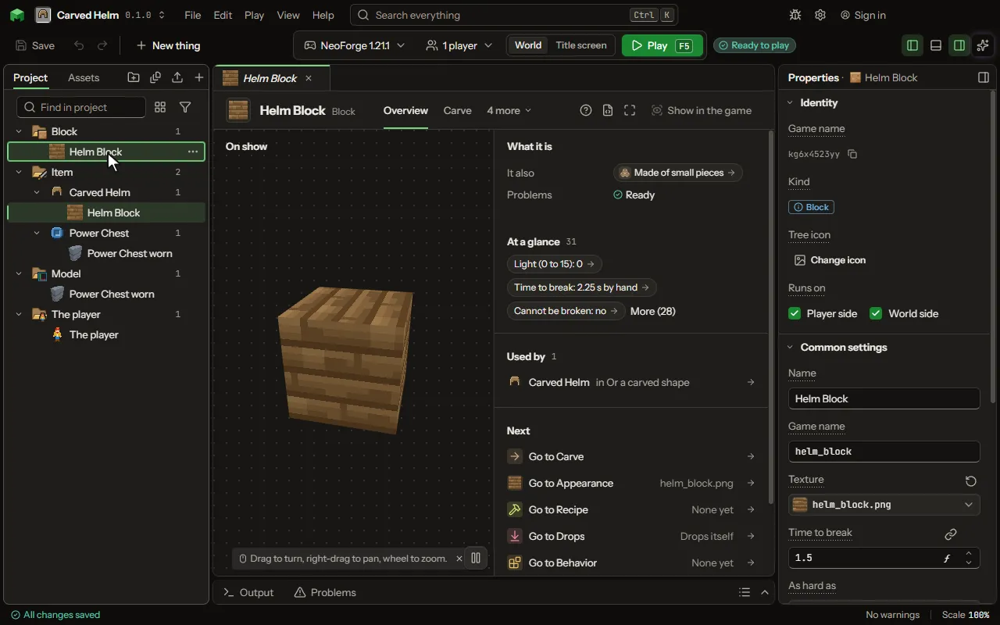

# Shared chest

A chest that is the same chest wherever it is placed: every shared chest on one channel holds the same items, in every world.

## How to add it

- New thing > Machines and networks > Shared chest

## What you can set

### Inventory

| Setting | What it does |
| --- | --- |
| Slots | How many stacks it holds, up to 256. Past six rows, its screen scrolls them or shows them all, as Screen shows says. From 1 to 256. |
| Screen shows | How its screen lays out more rows than six, until you lay it out on the Screen tab: six rows and a bar that scrolls the rest, or every slot at once in a screen grown to fit them. Choose one of: Six rows and a scroll bar, The whole grid at once. |
| Slots across | How many slots a row of its screen holds, 1 to 24. Past nine, the screen grows wider. From 1 to 24. |
| Items per slot | The most of one thing a slot takes. The game reads it live, so a mod setting can stand in. From 1 to 64. |
| Most a second | The most that moves in or out of it each second along a network. Hoppers keep their own speed. From 1 to 1024. |
| No limit | On: items cross this block as fast as the blocks at both ends can give and take. The number above is ignored. |
| Items travel at | How fast an item crosses this block on a pipe that passes items on. At nought an item arrives the moment the network moves it. Above nought it takes time to cross, pipe by pipe, and each pipe holds and keeps what is inside it. From 0 to 20 blocksPerSecond. |
| Shares the cards in it | Every value card put in it gives its value by its name, to the whole world or to the cable network it sits on, so a reader or a sum anywhere there can use the name. A card named in an anvil uses that name; otherwise the item's own. Choose one of: No, With the whole world, On its cable network. |
| Opens a screen | Used by hand, it opens its slots in a screen laid out on the Screen tab. |
| Takes back with | Empty hand: any empty hand takes the item back. Sneaking: only an empty hand while sneaking does. Choose one of: An empty hand, Sneaking, empty hand. |
| Put in and take out by hand | A block with no screen takes the stack in the player's hand when used, and gives it back to an empty hand (sneaking or not), as a lectern or a decorated pot does. Turn it off when only machines and commands fill it. |
| Screen | The machine's screen, laid out on the Screen tab. Until it is changed there, the product draws it from the slots and gauges. |

### Connections

| Setting | What it does |
| --- | --- |
| Faces | Which of the six faces connect, and to what. Open the Connections tab to set them. |
| What arrives | A cable or a pipe passes it on and holds nothing. A machine, a tank or a battery keeps it. Choose one of: It keeps it, It passes it on. |
| Served before others | When several blocks want the same thing and there is not enough, the higher number is filled first. Equal numbers take turns. From -64 to 64. |
| Serves first | Whom what leaves it goes to first, for items, fluids and every stock: shared by priority, each block in turn, or the nearest along the pipes. Choose one of: By priority, Each in turn, The nearest. |
| Faces have colours | A coloured face joins only faces of its colour. Off, faces ignore colour. |
| Dyes a face steps through | How many of the sixteen dyes a channel can be set to. From 1 to 16. |
| Face modes | What pressing a face goes through, in order. Empty keeps Off, In, Out, Both. Each row has: Name, Colour, Does. |
| Players set each face | A player right-clicks a face with an empty hand and sets what it does on that placed block alone. The table is where every placed block starts. |
| Face screen | The screen a player opens by right-clicking a face of the placed block, laid out on the Face screen tab. Until it is changed there, the product draws its own rows. |
| Items a face filters | How many items a player can mark on a face, to let only those through or to keep them out. A mark is not the item: nothing is taken from the player. From 0 to 9. |
| Filter of your own | A piece of your own code that answers yes or no for each item, asked on every face beside the marks, for what the marks cannot say: damage, data, a stock level. |
| Speed upgrade | An item a player puts into a face's upgrade slot on its screen. Each one moves that face's rate again, eight at most; they drop when the block is broken. |
| Reserve room for items | An item riding through this pipe holds its place in the chest or machine it is going to, so two stacks never fight for one slot and nothing has to turn round. Turn it off and a stack just goes to the nearest place with room right now. |
| Item to link a chest | Pick an item and this block becomes a node that reaches a chest or machine without a cable. A player right-clicks the chest with the item, then right-clicks this block with it, and the network uses that chest as if it stood against the top of this block. Sneak and right-click the block to cut the link. Leave empty for a plain block. |
| How far a link reaches | The most blocks between this node and the chest it is linked to, in the same dimension. 0 means any distance. From 0 to 1024 blocks. |
| When it is broken | A block that carries more than one thing (items and fluid and energy, say) can come apart one thing at a time: mining it takes off the one added last and leaves the rest standing. Sneaking while you mine breaks the whole block. Choose one of: The whole block goes, One piece at a time. |
| Item for the items piece | What drops when the items part is taken off, and what a player uses on the block to put it back. Leave empty and a part taken off is gone. |
| Item for the fluid piece | What drops when the fluid part is taken off, and what a player uses on the block to put it back. Leave empty and a part taken off is gone. |
| Item for the energy piece | What drops when the energy part is taken off, and what a player uses on the block to put it back. Leave empty and a part taken off is gone. |
| Holds parts | Face parts go on its faces, one a face and one in the middle, and covers take another block's look. A face with no part joins only blocks of this mod, never a chest. |
| Moves by itself | Its out sides push into the blocks beside them and its in sides pull from them, with no pipe between: a machine filling the chest next to it, a block emptying a cart in front of it. Works for items, fluids, energy and your own stocks. Choose one of: No, Pushes out, Pulls in, Pushes and pulls. |
| How much a second | How much it moves each second through each side: items, or the units of a fluid, energy or stock. From 1 to 100000 perSecond. |
| Holds a cart | Stops the cart that rolls up beside it while it works, so the cart stays until the block has moved all it can, or until a rule lets it go. Needs Moves by itself. Choose one of: No, Until it has nothing more to move, Until a rule lets it go. |
| Longest it holds | The most seconds it holds one cart, so a cart is never kept for good. 0 holds as long as it takes. From 0 to 86400 seconds. |
| Destroys what none take | What no other block on its pipes takes is destroyed here, after every other block had its turn. Marks on its sides say what it destroys; with none, everything. |
| Fills a block | Whether its sides fill a block whenever it has room, or only while it holds none of what comes (one stack in each furnace, never two). Choose one of: Whenever it has room, Only when it holds none. |
| Stands in for a far block | Linked to a far chest or machine with the linking item, this block is that chest to hoppers, pipes and other mods: what goes in here goes there, and what is taken from here comes from there. |
| Joins without a seam | Where an arm of this block meets one of these, neither draws the end of its arm, so a run of them reads as one tube. A machine or a chest it meets keeps its end and its plate. Choose one of: As its pictures say, Blocks like it, Every cable or pipe it joins, Nothing. |

### Linked by a channel

| Setting | What it does |
| --- | --- |
| Channel | The name that links it: blocks on the same channel are linked. A player renames a block in an anvil before placing it to put that one on another channel. |
| On its channel it | Sends: what it holds, and the redstone reaching it, go out on the channel, and its faces take in. Receives: it gets what is sent, gives out the channel's signal, and its faces give out. Shares: it holds what every sharing block on the channel holds, one chest or one tank in many places, in every world, kept by the world even while none of them is loaded. Choose one of: sends, receives, shares, jams. |
| Carries a redstone signal | A sending block sends the redstone that reaches it; a receiving block gives out the strongest signal on its channel. |
| Reaches | How far the link reaches, in blocks. 0 reaches anywhere, in every world. From 0 to 100000 blocks. |
| Only its owner's | The channel belongs to the player who placed it: another player's block on a channel of the same name is not linked to it. |

Every block also has the settings on the [Block](editor-block.md) page.

## What it becomes in the game

It is added to the game, so a player needs your mod to see it.

It comes with these abilities already on: Inventory, Connections, Linked by a channel.

## What it works with

It points at: [Model](editor-model.md), [Sound](editor-sound.md), [Particle](editor-particle.md), [Item](editor-item.md), [Code](editor-code.md).

Other things that open the same editor: [Block](thing-block.md), [Machine](thing-machine.md), [Generator](thing-generator.md), [Cable](thing-cable.md), [Pipe](thing-pipe.md), [Item pipe](thing-itemPipe.md), [Tank](thing-tank.md), [Transmitter](thing-wirelessTransmitter.md), [Receiver](thing-wirelessReceiver.md), [Wireless energy node](thing-wirelessNode.md), [Shared tank](thing-sharedTank.md), [Chest](thing-chest.md), [Drawer](thing-drawer.md), [Storage crate](thing-crate.md), [Mailbox](thing-mailbox.md), [Trade station](thing-tradeStation.md), [Asking chest](thing-askingChest.md), [Terminal](thing-terminal.md), [Storage cell](thing-storageCell.md), [Storage cable](thing-storageCable.md), [Drive](thing-drive.md), [Network heart](thing-networkHeart.md), [Dense cable](thing-denseCable.md), [Link](thing-storeLink.md), [Access point](thing-accessPoint.md), [Crafter](thing-crafter.md), [Pattern table](thing-patternTable.md), [Matter tank](thing-matterTank.md), [Altar](thing-altar.md), [Pedestal](thing-pedestal.md), [Formed machine](thing-formedMachine.md), [Machine casing](thing-machineCasing.md), [Waypoint](thing-waypointBlock.md), [Aiming block](thing-aimingBlock.md), [Berry bush](thing-berryBush.md), [Matter pipe](thing-matterPipe.md), [Assembly station](thing-assemblyStation.md), [Carved block](thing-carvedBlock.md), [Ore](thing-ore.md), [Crop](thing-crop.md), [Plant](thing-plant.md).

## Picture

## Related pages

- [Block](editor-block.md)
- [Templates and samples](templates-and-samples.md)
- [Glossary](glossary.md)
