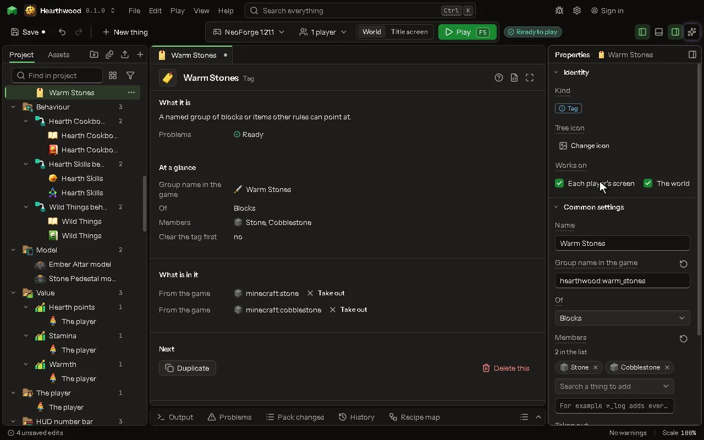

# Tag

A named group of blocks or items other rules can point at.

## How to add it

- New thing > Logic and code > Tag

## What you can set

The main settings are below. The [Tag](editor-tag.md) editor lists every setting.

| Setting | What it does |
| --- | --- |
| Name | What you call this group. |
| Group id | The game's id for the group, like minecraft:mineable/pickaxe. A vanilla one gets your members added; a new one is yours. |
| Of | What the group holds: blocks, items, biomes, structures, mobs, fluids, kinds of hurt or enchantments. Choose one of: Blocks, Items, Biomes, Structures, Mobs, Fluids, Kinds of hurt, Enchantments. |
| Members | The ids in the group, separated by spaces. Another group goes in with a # in front. |
| Taken out | Members taken out of the tag, whoever put them in: the game, another mod. Ids or #tags, separated by spaces. |
| Clear the tag first | Drops everything the game and other mods put in this tag. Only the members you list here stay. |

## What it becomes in the game

It is written into the mod when you [Cook](glossary.md#cook) or press [Play](glossary.md#play).

## What it works with

It does not point at other things.

## Picture

## Related pages

- [Tag](editor-tag.md)
- [Templates and samples](templates-and-samples.md)
- [Glossary](glossary.md)
