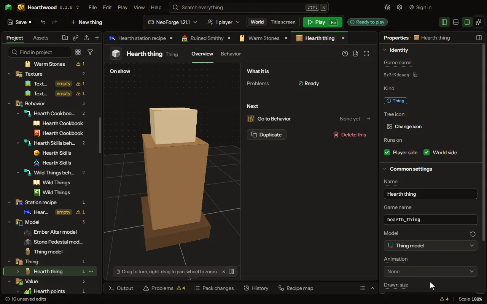

# Thing

Something in the world that is not a mob and does not fly: a spell's ward, a frame on a wall, a floating orb, a balloon on a string, a trap. Made by a rule word, drawn by a model.

## How to add it

- New thing > Mobs and models > Thing

## What you can set

The main settings are below. The [Thing](editor-thing.md) editor lists every setting.

| Setting | What it does |
| --- | --- |
| Name | What players read above it, in any words: spaces and capitals are fine, like "Ruby Blade of Sam". The Game name is the short id the game uses instead. |
| Game name | The id the game and its commands use: small letters, digits and underscores, like katana. In commands and recipes the mod's id and a colon go in front: for a mod called rubygear, katana is written rubygear, a colon, then katana. Players never read it; that is the Name. Change it later and it is renamed everywhere. |
| Model | The model it is drawn by, made in the model editor. Its front faces out of a wall it hangs on. |
| Animation | A clip it plays over and over as it stands. |
| Drawn size | How big its model is drawn: 1 is the model's own size. From 0.0625 to 16. |
| Width | How wide it is, in blocks: what can be hit and what it bumps into. From 0.05 to 16 blocks. |
| Height | How tall it is, in blocks. From 0.05 to 16 blocks. |
| When walked into | Walked through, stood on and bumped into like a block, or pushed along. Choose one of: Walked through, Solid, Pushed along. |
| Stays for | How long it stays before it ends by itself. 0 stays until it is broken. From 0 to 3600 seconds. |
| Breaks after | How much it takes from hits before it breaks. 0 never breaks from hits (a player in creative still breaks it). From 0 to 1000 hearts. |
| Where it hangs | Where it is made (in the air), flat on the face of a block, or beside the one who made it. Choose one of: Where it is made, On a block's face, Beside its owner, Pinned to a block, On top of a block. |
| Area | How far round it reaches, in blocks: the mobs inside are touched so often. 0 has no area. From 0 to 32 blocks. |
| Holds an item | A player puts an item in by using it and takes it out with an empty hand; it shows the item and drops it when it breaks. |

## What it becomes in the game

It is added to the game, so a player needs your mod to see it.

## What it works with

It points at: [Model](editor-model.md), [Animation](editor-animation.md).

## Picture

## Related pages

- [Thing](editor-thing.md)
- [Templates and samples](templates-and-samples.md)
- [Glossary](glossary.md)
