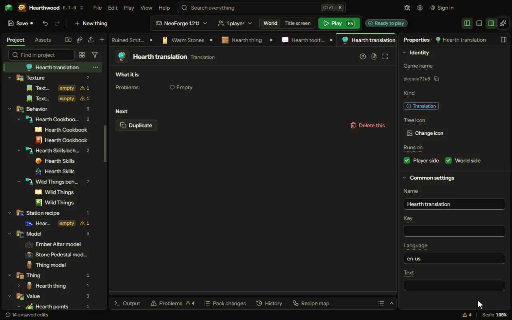

# Translation

The names of your things in another language.

## How to add it

- New thing > Logic and code > Translation

## What you can set

The main settings are below. The [Translation](editor-translation.md) editor lists every setting.

| Setting | What it does |
| --- | --- |
| Name | What you call this line. |
| Key | The game's key for the text, like block.minecraft.stone. |
| Language | The language code, like en_us or de_de. |
| Text | What players read in that language. |

## What it becomes in the game

It is written into the mod when you [Cook](glossary.md#cook) or press [Play](glossary.md#play).

## What it works with

It does not point at other things.

## Picture

## Related pages

- [Translation](editor-translation.md)
- [Templates and samples](templates-and-samples.md)
- [Glossary](glossary.md)
