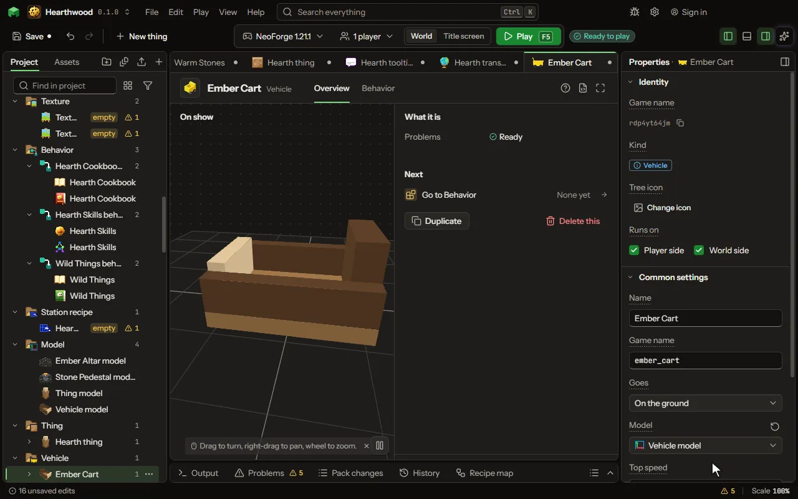

# Vehicle

Something to ride that is not alive, beyond the boat: a cart, a motor boat, a broom or an airship, a minecart of its own, a ride along a path. Steered with the game's own keys, with seats, fuel, cargo and parts.

## How to add it

- New thing > Blocks and items > Vehicle

## What you can set

The main settings are below. The [Vehicle](editor-vehicle.md) editor lists every setting.

| Setting | What it does |
| --- | --- |
| Name | What players see it called. |
| Game name | The name the game knows it by, in small letters. |
| Goes | How it goes: on the ground, on water, in the air, on the game's rails, or along a path of blocks with its riders inside. Choose one of: On the ground, On water, In the air, On rails, Along a path. |
| Looks like | The game's own minecart, with a block in it, or a model of its own. Choose one of: The game's minecart, Its own model. |
| Block in the cart | A block drawn inside the cart, by its game name, as a chest or a furnace in the game's own carts. Empty shows none. |
| Model | The model it is drawn by, made in the model editor. Its front is the way it goes. |
| Top speed | How fast it goes at most, in blocks a second. A horse runs about 10, a boat about 8. From 0 to 60 blocksPerSecond. |
| Climb | How fast it rises with the jump key and sinks with the sprint key, in blocks a second. From 0 to 40 blocksPerSecond. |
| Flies by | How it flies: hovering (a broom, a drone: the jump key rises, the sprint key sinks), on wings (a plane: its speed lifts it, it banks to turn and glides without power), or by thrust (a rocket: its engine against its weight). Choose one of: Hovering, Wings, Thrust. |
| Take-off speed | How fast it must go before its wings lift it, in blocks a second. Slower in the air, it stalls and drops its nose. From 0 to 60 blocksPerSecond. |
| Thrust | How hard its engine pushes up while the jump key fires it. More thrust than weight lifts it; a rule may set it from its engine blocks. From 0 to 100000. |
| Weight | How heavy it is against its thrust. A rule may set it from the blocks it is built of. From 0.01 to 100000. |
| Path of | The block it follows, by its game name, or a tag after a #. It goes straight on, turns where the line turns, takes the side its rider looks to where the line splits, and stops at the end. |
| Seats | How many can ride it. The first one on drives. From 1 to 8. |
| Fuel | What it needs to go: nothing, items put in, a fluid by the bucket, or whatever its rules give it. Empty, it stops. Choose one of: Nothing, Items put in, A fluid, What its rules give. |
| Fuel item | The item it burns, by its game name, or a tag after a #. Used on it, or kept in its cargo, it fills it. |
| Fuel fluid | The fluid it runs on, by its game name. A bucket of it used on it fills it, and the bucket comes back empty. |
| Fuel it holds | The most fuel it holds. From 1 to 1000000. |
| Fuel from one | How much fuel one item or one bucket gives. From 0 to 1000000. |
| Fuel used | How much fuel a second of going takes. Standing still takes none; holding its height in the air does. From 0 to 100000 perSecond. |
| Cargo | Rows of nine slots it carries, opened by crouching and using it. 0 carries nothing. From 0 to 6. |
| Part slots | How many parts a player can put in by using a part on it. From 0 to 8. |
| Its item | The item it drops when it breaks, and gives back when it packs up. |

## What it becomes in the game

It is added to the game, so a player needs your mod to see it.

## What it works with

It points at: [Model](editor-model.md), [Animation](editor-animation.md), [Block](editor-block.md), [Item](editor-item.md).

## Picture

## Related pages

- [Vehicle](editor-vehicle.md)
- [Templates and samples](templates-and-samples.md)
- [Glossary](glossary.md)
