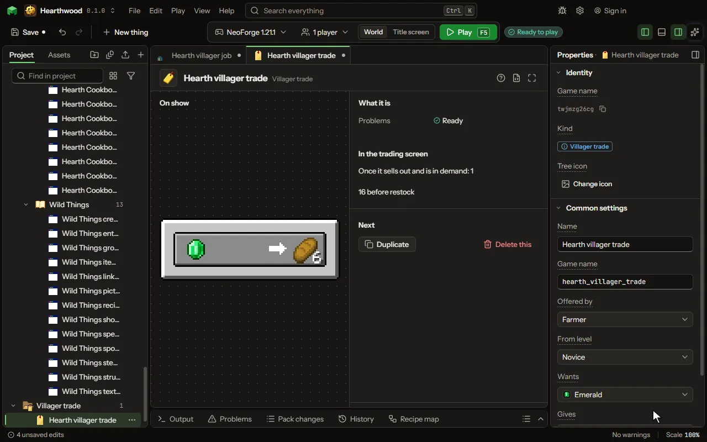

# Villager trade

What a villager offers and asks for.

## How to add it

- New thing > Crafting and loot > Villager trade

## What you can set

The main settings are below. The [Villager trade](editor-villagerTrade.md) editor lists every setting.

| Setting | What it does |
| --- | --- |
| Name | A name for you. Players see what is traded. |
| Game name | The trade's name in the game, as a data pack names it. |
| Offered by | Which villager offers it, or the wandering trader. Choose one of: Armorer, Butcher, Cartographer, Cleric, Farmer, Fisherman, Fletcher, Leatherworker, Librarian, Mason, Shepherd, Toolsmith, Weaponsmith, The wandering trader. |
| From level | The villager's level it is first offered at: a novice's trades are the first two it has. Choose one of: Novice, Apprentice, Journeyman, Expert, Master. |
| Rare | Among the wandering trader's rare offers rather than its common ones. |
| Wants | What the player pays. |
| Gives | What the player gets. |
| How many it wants | How many, before demand raises the price. From 1 to 64. |
| How many it gives | How many, before demand raises the price. From 1 to 64. |

## What it becomes in the game

It is not part of the game itself: it describes another mod or a file, so it has no side to choose.

## What it works with

It points at: [Villager job](editor-villagerProfession.md).

## Picture

## Related pages

- [Villager trade](editor-villagerTrade.md)
- [Templates and samples](templates-and-samples.md)
- [Glossary](glossary.md)
