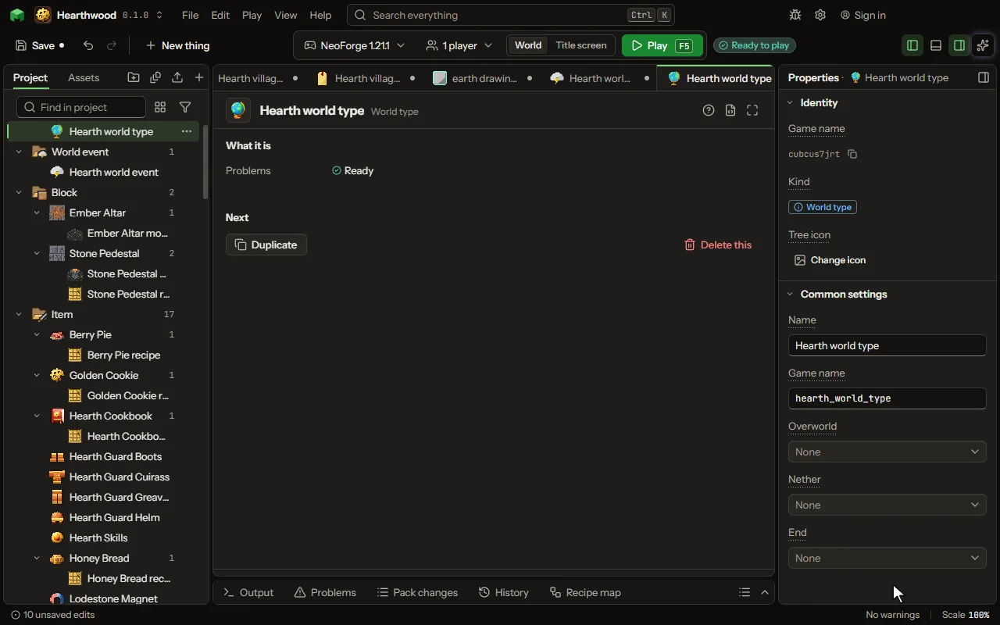

# World type

A choice on the game's Create New World screen. Each of the three worlds it makes stands on a dimension of yours, or on the game's own when you name none: a void world with a start island, a world of islands, a flat one.

## How to add it

- New thing > The world > World type

## What you can set

The main settings are below. The [World type](editor-worldType.md) editor lists every setting.

| Setting | What it does |
| --- | --- |
| Name | What the Create New World screen calls it. |
| Game name | The world type's name in the game. |
| Overworld | The dimension of yours the overworld is made as. Left empty, the game's own overworld. |
| Nether | The dimension of yours the nether is made as. Left empty, the game's own nether. |
| End | The dimension of yours the end is made as. Left empty, the game's own end. |

## What it becomes in the game

It is not part of the game itself: it describes another mod or a file, so it has no side to choose.

## What it works with

It points at: [Dimension](editor-dimension.md).

## Picture

## Related pages

- [World type](editor-worldType.md)
- [Templates and samples](templates-and-samples.md)
- [Glossary](glossary.md)
